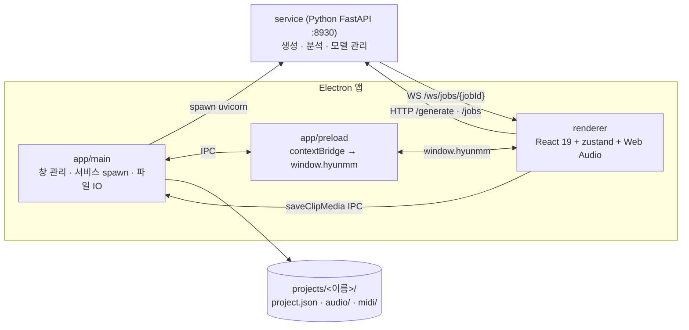
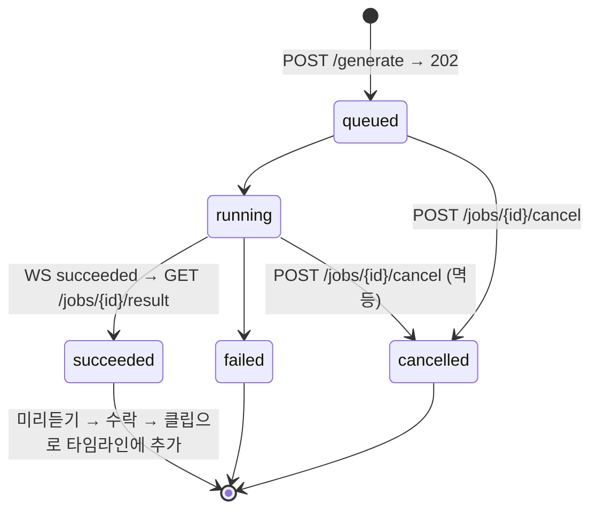

<div align="center">

# hyunMM

사람이 DAW로 음악을 조작하면 AI가 프로젝트 맥락(트랙·클립·BPM·키)을 이해하고<br>
**클립 단위로 함께 편곡·생성하는 AI DAW 데스크톱 앱**입니다.


</div>

> hyunMM은 "프롬프트 → 완성곡" 생성기가 아닙니다. **사용자가 주체**이고 AI는 협업자입니다. AI 출력은 완성곡이 아니라 타임라인에 올라가는 **클립**이며, 수락·수정·삭제는 사용자가 합니다. 이 정의가 모든 기능 판단의 기준입니다 ([`CLAUDE.md`](./CLAUDE.md)).

## 한눈에 보기

| 영역 | 내용 |
| --- | --- |
| 제품 정체성 | AI DAW — DAW가 본체, AI는 현재 프로젝트 상태를 컨텍스트로 받아 클립 단위로 협업 |
| 앱 구조 | Electron 통합 앱 + 로컬 Python AI 서비스(FastAPI, 포트 `8930`) |
| 실시간 오디오 | 렌더러의 Web Audio 엔진에서 처리 — Python 왕복 없음(저지연) |
| AI 생성·분석 | Python 서비스가 전담. 비동기 job, 진행률은 WebSocket 스트리밍, **항상 취소 가능** |
| 저장 | DB 없음. 로컬 프로젝트 파일(`projects/<이름>/project.json` + `audio/` `midi/` `samples/`) |
| 현재 단계 | MVP 1~4 완료 — 계약 v1, transport/timeline, **mock 생성기** 왕복, 드럼패드·키·믹서 UI |
| 검증 | typecheck 0 · lint 0 · vitest 9 · pytest 10 ([현재 점검 상태](#현재-점검-상태)) |

## 저장소 구성

| 경로 | 역할 | 스택 | 검증 |
| --- | --- | --- | --- |
| [`app/`](./app) | Electron main · preload · 공유 상수 | Electron 33 · TS strict | `npm run typecheck` |
| [`renderer/`](./renderer) | DAW 본체 UI + Web Audio 엔진 | React 19 · zustand 5 · Vite 5 | typecheck · lint · vitest |
| [`service/`](./service) | 로컬 AI 서비스 — 생성(오디오/MIDI)·분석·모델 관리 | Python 3.11+ · FastAPI · Pydantic v2 | compileall · pytest |
| [`docs/`](./docs) | renderer↔service API 계약, 기획서, 구조 설계·구조 문서 | Markdown · HTML | — |
| [`projects/`](./projects) | 사용자 프로젝트 파일 (gitignore 대상) | — | — |

> 단일 저장소(모노레포)로 관리합니다. 서비스 포트 `8930`은 [`app/shared/servicePort.ts`](./app/shared/servicePort.ts)와 [`service/app/main.py`](./service/app/main.py) 두 곳에 상수로 존재하며, 바꾸면 둘 다 바꿉니다.

## 시스템 구조



| 계층 | 책임 | 하지 않는 것 |
| --- | --- | --- |
| Renderer (React + Web Audio) | UI, 재생·믹싱·이펙트 등 실시간 오디오, 클라이언트 상태 | AI 추론 |
| Electron main | 창, Python 서비스 프로세스 생명주기, 프로젝트 파일 IO | 도메인 로직 |
| Python 서비스 | AI 생성(오디오/MIDI), 오디오 분석, 모델 로드/언로드·VRAM 관리 | 실시간 재생 |

### 생성 job 흐름



렌더러 쪽 경로: `AiCopilotPanel` → `buildContextSnapshot`(프로젝트 상태 화이트리스트 매핑) → `useGenerationJob`(job 수명 관리, WS 단절 시 1초 간격 `getJob` 폴링 폴백) → `serviceClient`(HTTP + WS 호출, 재연결 없음) → `usePreviewPlayer`(미리듣기) → 수락 시 `window.hyunmm.saveClipMedia` IPC로 `projects/<이름>/audio/<clipId>.wav` 저장 후 트랙·클립 추가.

## 구현 현황

2026-10-17 기준, 코드에서 확인한 상태입니다. **구현됨 / Mock / 미구현**을 구분합니다.

| 영역 | 상태 | 내용 | 근거 |
| --- | --- | --- | --- |
| Transport | 구현됨 | 재생/정지, BPM(20~300), 메트로놈(lookahead 스케줄링), 재생 중 BPM 변경 시 anchor 재기준화 | `renderer/src/audio-engine/transport.ts`, `metronome.ts` |
| Timeline | 부분 | 트랙 레인·클립 블록·비트 룰러·rAF 플레이헤드 **표시**. 클립 드래그/리사이즈·클립 오디오 재생 없음 | `renderer/src/features/timeline/` |
| 드럼패드 | 구현됨 | 8패드 합성 드럼(샘플 없음), 마우스 + 핫키. 비트 녹음 없음 | `features/drum-pad/`, `audio-engine/drumSynth.ts` |
| 가상 키보드 | 구현됨 | 2옥타브 온스크린 + 컴퓨터 키보드, saw+ADSR 8보이스 폴리. 외부 MIDI 입력 없음 | `features/keys/`, `audio-engine/keySynth.ts` |
| 믹서 | 부분 | 볼륨·팬·뮤트·솔로가 store에만 반영. **오디오 그래프 미연결** | `features/mixer/Mixer.tsx` |
| AI Copilot | 구현됨 (Mock 백엔드) | 프롬프트 → 생성 → 진행률 → 미리듣기 → 수락/거절/취소 왕복. 현재 오디오 출력만(MIDI UI 비활성) | `features/ai-copilot/` |
| 생성 API 계약 v1 | 구현됨 | `/generate` `/jobs` `/cancel` WS — renderer 타입 · pydantic 스키마 · 문서 3자 일치, pytest 10건 | [`docs/api/generation.md`](./docs/api/generation.md) |
| 생성기 | **Mock** | stdlib로 합성 톤 WAV / SMF 0 MIDI 생성. 프롬프트 내용은 무시됨. 실모델(MusicGen 계열 후보) 미도입 | `service/app/generation/` |
| 프로젝트 저장/로드 | 미구현 | `project.json` 읽기/쓰기 IPC 없음. 수락 클립의 WAV만 디스크에 쓰고 store는 세션 한정 | `renderer/src/app/state/useProjectStore.ts` |
| 이펙트 랙 · 오토메이션 | 미구현 | 스텁 컴포넌트, App에 미마운트 | `features/effects/`, `features/automation/` |
| 오디오 분석 (`/analyze`) | 미구현 | 501 반환. BPM·키·온셋 분석 계약 미정의 | `service/app/api/routes.py` |
| 모델 관리 | 미구현 | `NotImplementedError` | `service/app/models/model_manager.py` |
| 패키징(설치 파일) | 미구현 | 개발 모드(`npm run dev`)가 유일한 실행 경로 | [배포 현황](#배포-현황과-다음-단계) |

## 기술 구조

| 레이어 | 주요 파일 | 역할 |
| --- | --- | --- |
| Electron main | `app/main/index.ts` | 창 생성, `service/.venv`의 uvicorn spawn/종료, `project:saveClipMedia` IPC(경로 검증 후 저장) |
| Preload | `app/preload/index.ts` | `window.hyunmm` 노출 — `platform`, `serviceUrl`, `saveClipMedia` |
| 서비스 클라이언트 | `renderer/src/app/serviceClient.ts` | `postGenerate` · `getJob` · `fetchJobResult` · `cancelJob` · `openJobSocket`, 에러 봉투 파싱 |
| 상태 | `renderer/src/app/state/useProjectStore.ts` · `useTransportStore.ts` | 프로젝트(트랙·클립) store, 저빈도 transport 상태(bpm·isPlaying). 재생 위치는 store에 두지 않음 |
| 타입·계약 | `renderer/src/app/types/project.ts` · `serviceContract.ts` | project.json 스키마 v1, wire 계약 타입 |
| 오디오 엔진 | `renderer/src/audio-engine/*` | 단일 AudioContext, transport(anchor + bpm), 메트로놈(lookahead 예약), 드럼·키 신스. rAF 경로(재생 위치 읽기)는 무할당 |
| 화면 | `renderer/src/features/*` | transport · timeline · dock(드럼패드/키/믹서 탭) · ai-copilot |
| 서비스 API | `service/app/api/routes.py` · `jobs.py` · `schemas.py` | 엔드포인트, job 매니저(동시 1개), pydantic 스키마 |
| 생성기 | `service/app/generation/*` | `music_generator`(WAV) · `midi_generator`(SMF), beat 단위 취소 체크포인트 |

### API 엔드포인트 (v1)

| 메서드 | 경로 | 응답 | 비고 |
| --- | --- | --- | --- |
| `GET` | `/health` | `{"status":"ok"}` | 연결 확인 |
| `POST` | `/generate` | `202 GenerateJob` | 즉시 반환, 작업은 비동기. 진행 중 재요청은 `409 SERVICE_BUSY` |
| `GET` | `/jobs/{jobId}` | `200 GenerateJob` | 상태 스냅샷(WS 단절 복구용) |
| `GET` | `/jobs/{jobId}/result` | `audio/wav` 또는 `audio/midi` | `succeeded`에서만 |
| `POST` | `/jobs/{jobId}/cancel` | `202 CancelResponse` | **멱등** — 종료된 job이면 `already_finished` |
| `WS` | `/ws/jobs/{jobId}` | `JobWsMessage` 스트림 | 접속 즉시 현재 상태 1회 송신 후 이벤트 스트림 |
| `POST` | `/analyze` | `501` | 미구현 |

공통 규칙(단위·ID·에러 봉투)은 [`docs/api/conventions.md`](./docs/api/conventions.md), 상세는 [`docs/api/generation.md`](./docs/api/generation.md).

---

## 1. 새 PC에서 처음 실행하기

### 요구사항

| 도구 | 버전 | 확인 |
| --- | --- | --- |
| Node.js | 22+ (`@types/node` 22 기준) | `node -v` |
| Python | 3.11+ (`pyproject.toml` `requires-python`) | `python --version` |
| Git | — | `git --version` |

### 셋업 (Windows PowerShell 기준)

```powershell
git clone https://github.com/goo-hyunju/hyunMM.git
cd hyunMM

# 1) Node 의존성
npm install

# 2) Python 서비스 가상환경 (경로가 service\.venv 여야 앱이 찾는다)
cd service
python -m venv .venv
.venv\Scripts\pip install -e ".[dev]"
cd ..

# 3) 실행 — 앱 창이 뜨고 Python 서비스(8930)도 자동으로 함께 뜬다
npm run dev
```

macOS/Linux는 `.venv\Scripts\` 대신 `.venv/bin/`을 쓰면 됩니다 (`.venv/bin/pip install -e ".[dev]"`).

> **venv 경로 주의:** Electron이 `service/.venv/Scripts/uvicorn.exe`(win32) 또는 `service/.venv/bin/uvicorn` 경로를 직접 실행합니다
> (`app/main/index.ts`의 `spawnAiService`). venv를 다른 이름·위치에 만들면 서비스가 뜨지 않습니다.

### AI(생성) 기능까지 쓰려면

기본 설치는 **mock 생성기**로 동작합니다 — 생성 요청 → 진행률 → 결과 흐름 전체가 실제로 돌지만, 결과물은 합성 톤 WAV/MIDI입니다. 실제 AI 모델 추론용 의존성(torch 등, 수 GB)은 선택 설치입니다:

```powershell
cd service
.venv\Scripts\pip install -e ".[ai]"
```

> 실모델 연결 코드는 아직 없습니다. `ai` 그룹은 의존성 선언만 되어 있고, 모델 도입 전에 라이선스(상업적 사용 가능 여부)를 확인해 `docs/`에 기록합니다.

GPU가 없거나 사양이 낮은 PC는 이 단계를 건너뛰고 아래 **원격 AI 서버 모드**를 쓰면 됩니다.

### AI가 안 떠도 괜찮다

서비스 spawn이 실패해도 앱은 죽지 않습니다 — **DAW 본체는 그대로 동작하고 AI 기능만 비활성**이 됩니다
(`app/main/index.ts`의 `serviceProcess.on('error')` 처리). Python이 없는 PC에서도 DAW로는 쓸 수 있습니다.

---

## 2. 원격 AI 서버 모드 — 다른 PC의 AI를 빌려 쓰기

AI를 돌릴 수 없는 PC(클라이언트)에서, AI가 도는 PC(서버)를 켜두고 그쪽 서비스에 접속하는 구성입니다.

```
[클라이언트 PC]                         [서버 PC]
hyunMM 앱 (DAW 본체)  ──HTTP/WS──▶  Python AI 서비스 (0.0.0.0:8930)
로컬 서비스는 띄우지 않음               npm run service:serve
```

### 서버 PC (AI가 도는 쪽)

```powershell
# 1) 서비스만 외부 접속 허용으로 실행 (0.0.0.0 바인딩)
npm run service:serve

# 2) 이 PC의 LAN IP 확인 (예: 192.168.0.10)
ipconfig
```

Windows 방화벽이 첫 실행 때 허용 여부를 물으면 **개인 네트워크 허용**. 프롬프트가 안 떴거나 접속이 막히면 수동으로 엽니다 (관리자 PowerShell):

```powershell
netsh advfirewall firewall add rule name="hyunMM AI Service" dir=in action=allow protocol=TCP localport=8930
```

### 클라이언트 PC (DAW를 쓰는 쪽)

셋업 1번(`git clone` + `npm install`)까지만 하면 됩니다. **Python venv 불필요.** 환경변수로 서버 주소를 주고 실행합니다:

```powershell
$env:HYUNMM_SERVICE_URL = "http://192.168.0.10:8930"   # 서버 PC의 IP
npm run dev
```

`HYUNMM_SERVICE_URL`이 설정되면 앱은 로컬 Python 서비스를 띄우지 않고 해당 주소로 접속합니다. 해제하려면 새 터미널에서 실행하거나 `Remove-Item Env:HYUNMM_SERVICE_URL`.

연결 확인: 클라이언트 PC 브라우저에서 `http://<서버IP>:8930/health`가 `{"status":"ok"}`를 반환하면 정상입니다.

### 인터넷 너머(외부)에서 접속하기 — Tailscale 권장

`HYUNMM_SERVICE_URL` 자체는 어떤 주소든 받습니다. 문제는 보안입니다 — 서비스에 인증이 없어서
**공유기 포트포워딩으로 8930을 인터넷에 직접 여는 것은 금지**입니다(주소를 아는 누구나, 포트 스캔 봇까지 접근 가능).

외부 접속은 [Tailscale](https://tailscale.com)(개인 무료)로 두 PC를 가상 LAN으로 묶는 방식을 씁니다.
포트포워딩·공인 IP 불필요, 트래픽 암호화, **본인 계정 기기만 접속 가능**하므로 인증 없는 현재 서비스로도 안전합니다.

```powershell
# 서버 PC · 클라이언트 PC 양쪽: Tailscale 설치 후 같은 계정으로 로그인
# https://tailscale.com/download

# 서버 PC — 서비스 실행은 동일 (0.0.0.0 바인딩이 Tailscale 인터페이스도 포함한다)
npm run service:serve
tailscale ip -4        # Tailscale IP 확인 (예: 100.101.102.103)

# 클라이언트 PC — Tailscale IP로 접속
$env:HYUNMM_SERVICE_URL = "http://100.101.102.103:8930"
npm run dev
```

방화벽 규칙(위 `netsh`)은 동일하게 필요합니다. 연결 확인도 동일: 브라우저에서 `http://<Tailscale IP>:8930/health`.

### 제약·주의

- **포트를 인터넷에 직접 노출하지 말 것.** LAN 밖 접속은 반드시 Tailscale 같은 VPN 경유. 공개 노출이 꼭 필요해지면 서비스에 API key 인증부터 구현해야 합니다(현재 미구현).
- 동시 생성은 서버 전체에서 **1개**입니다. 여러 명이 붙으면 두 번째 요청부터 `409 SERVICE_BUSY`를 받습니다 (`service/app/api/jobs.py`).
- 생성 결과 파일은 서버 PC의 `service/staging/`에 쌓입니다. 클라이언트는 HTTP로 바이트를 받아가므로 동작에는 문제없지만, 서버 디스크는 주기적으로 비워야 합니다(자동 정리 미구현).
- 서버 PC가 절전 모드로 들어가면 끊깁니다. 전원 옵션에서 절전을 꺼둘 것.

---

## 3. 명령어

```bash
npm run dev            # 앱 전체 기동 (main/preload/renderer + 서비스 spawn). 평소 개발은 이것 하나
npm run service:dev    # Python 서비스만 단독 실행 (127.0.0.1, --reload) — API 작업용
npm run service:serve  # Python 서비스를 외부 접속 허용(0.0.0.0)으로 실행 — 원격 AI 서버 모드용
npm run typecheck      # tsc --noEmit
npm run lint           # ESLint
npm run format         # Prettier --write (대상: TS/TSX/CSS/MJS/JSON — .prettierignore 참조)
npm run format:check   # Prettier --check
npm test               # vitest run
npm run build          # typecheck + electron-vite build
```

서비스 단독 검증:

```powershell
cd service
.venv\Scripts\python -m compileall -q app
.venv\Scripts\python -m pytest -q
```

- `npm run dev`와 `service:dev`/`service:serve`를 같은 PC에서 동시에 실행하면 포트 8930 충돌.
- 메인 개발 브랜치는 `develop`. 커밋은 `package.json` version bump(`release.feature.fix`) + 메시지 `version X.Y.Z, 작업내용` 형식.

## 현재 점검 상태

2026-10-17 기준, 로컬 작업트리(`develop`)에서 실행한 결과입니다.

| 항목 | 결과 |
| --- | --- |
| `npm run typecheck` | 통과 (오류 0) |
| `npm run lint` | 통과 (오류 0, 경고 0) |
| `npm run format:check` | 통과 |
| `npm test` | 2 파일 · 9 테스트 통과 (`transportMath`, `buildContextSnapshot`) |
| `python -m compileall app` | 통과 |
| `pytest` (service) | 10 테스트 통과 (계약 · 생성 job 흐름) |
| 실행 확인 | `npm run dev` 창 기동 · mock 생성 왕복은 MVP 4 당시 확인. 오디오 레이턴시·글리치는 자동 검증 대상 아님 |

## 문서

- **개발 규칙·아키텍처 요약:** [`CLAUDE.md`](./CLAUDE.md) · 작업 안내 [`AGENTS.md`](./AGENTS.md)
- **API 계약 (renderer ↔ service):** [`docs/api/conventions.md`](./docs/api/conventions.md) · [`docs/api/generation.md`](./docs/api/generation.md) · [`docs/api/project-schema.md`](./docs/api/project-schema.md)
- **기획 원본:** [`docs/planning/product-plan.md`](./docs/planning/product-plan.md)
- **구조 설계 결정:** [`docs/superpowers/specs/2026-08-24-ai-daw-structure-design.md`](./docs/superpowers/specs/2026-08-24-ai-daw-structure-design.md)
- **구조·원리 문서(HTML):** [`docs/hyunMM_구조_문서.html`](./docs/hyunMM_구조_문서.html) · 공통 문서 템플릿 [`docs/문서양식_템플릿.html`](./docs/문서양식_템플릿.html)

> API payload, WebSocket 메시지, `project.json` 스키마처럼 양쪽이 함께 영향을 받는 계약은 renderer 타입 · service 스키마 · `docs/api/` 문서를 **같은 커밋에서** 갱신합니다.

## 배포 현황과 다음 단계

설치 파일(더블클릭 실행) 패키징은 아직 없습니다 — 실행은 개발 모드(`npm run dev`)가 유일합니다.
패키징하려면 electron-builder 도입 + Python 런타임 번들링(`app/main/index.ts`의 spawn 경로가 `app.getAppPath()` 기준이라 asar 빌드에서는 동작하지 않음)이 필요합니다.

다음 MVP 순서:

1. `project.json` 저장/로드 IPC — 수락 클립의 영속성 완성
2. MIDI 프리뷰 (SMF 파서) 및 ai-copilot MIDI 출력 UI
3. 클립 오디오 재생 스케줄러 — 믹서 값을 오디오 그래프에 연결
4. 실모델(MusicGen 계열) 연결 — 라이선스 확인 선행
